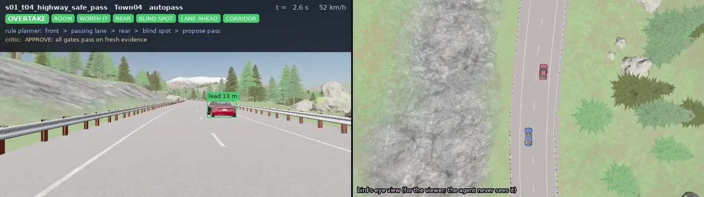

# AutoPass-Gen

**When should a simulated vehicle pass a slow lead under deadline pressure?** AutoPass-Gen separates evidence gathering, maneuver approval, and vehicle control. Replay a CARLA recording, inspect the corresponding decisions, or run the same Python decision core in your browser.

[Interactive lab](https://r800360.github.io/autopass/) · [Architecture](docs/SYSTEM.md) · [Evaluation](docs/EVALUATION.md) · [Release report](site/report.pdf)

## Run it

Python 3.10+ runs the kinematic simulator. Use Python 3.12 for the CARLA 0.9.16 client.

~~~bash
python -m pip install -e '.[dev]'
autopass run s17 --trace runs/rear.json.gz
autopass bench --out runs/catalog.json
autopass trip 'Depot to Clinic, urgent, within 33 seconds'
python -m pytest
~~~

For full sensor and vehicle-control runs, use the [CARLA guide](docs/CARLA.md). The default rule planner runs offline. Optional OpenAI-compatible inference, NanoDet RGB-depth perception, and learned steering have reproducible entry points.

## What to inspect

- **Closing rear traffic.** Compare the measured gap, estimated closing speed, rejection, and later commit.
- **Occluded oncoming lane.** A camera's visible extent limits the pass, even when its detections are empty.
- **Trip reroute.** Repeated pass denials raise the estimated cost of a congested road. The navigator can select a bypass at the next graph node.
- **Stress results.** Inspect collisions, conservative holds, and unsafe commits alongside completed overtakes. Download the individual records from the lab.

The [release report](site/report.pdf) gives denominators and known limitations. The validation scope is simulation. The [original release](https://github.com/r800360/autopass-gen/tree/8b424e2bbbe64391be2a9c74351f6a505e0f943d) and [team contributions](docs/CONTRIBUTIONS.md) document the project's origins.

MIT · [Contributors and third-party models](docs/CONTRIBUTIONS.md)
